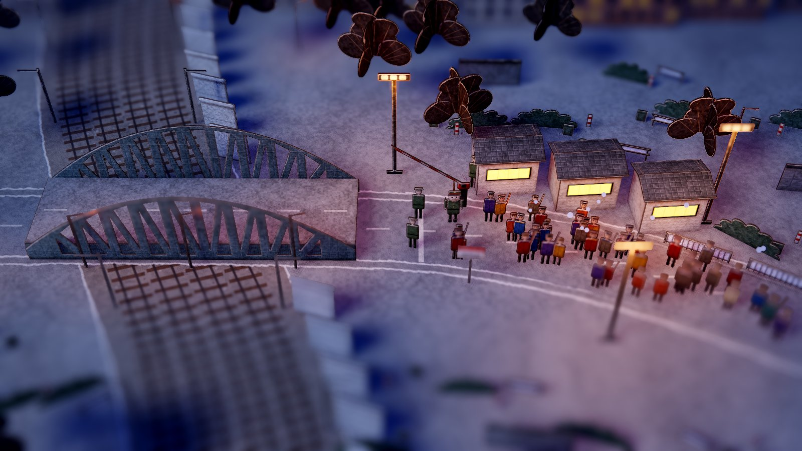
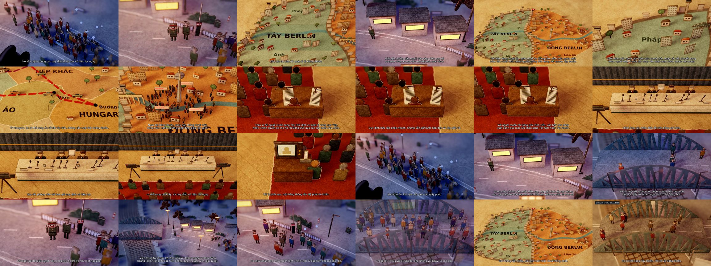

# Cửa khẩu Bornholmer bằng papercraft (dựng thử)

Cảnh thử cho phim tài liệu về đêm Bức tường Berlin mở cửa (đoạn N21a–N21b, khoảng 23:30 ngày 9/11/1989). Dựng bằng skill [papercraft](../../animation/papercraft.md) trên máy không có GPU, ngày 2026-11-25.



## Trong cảnh có gì

| Thành phần | Cách dựng |
|---|---|
| Cầu Bösebrücke | Mặt cầu là `platform`; hai giàn vòm thép là card in đinh tán, khoét 18 lỗ để thành ô giàn |
| Đường ray dưới cầu | In xuống nền: dải đá dăm, 4 đường ray, tà vẹt |
| Đường Bornholmer | In xuống nền, uốn từ trạm kiểm soát lên cầu (đường dẫn mắt chính), vạch kẻ, vạch dừng |
| Trạm kiểm soát | 3 chòi gác `boxFold` có cửa sổ phát sáng; barie sọc đỏ trắng **đang nâng**; 3 cột đèn pha; biển báo; hàng rào chắn |
| Người | 46 người, mỗi người một card in màu áo, khăn, mũ riêng; vài người giơ tay. 3 lính gác; viên sĩ quan (nhân vật chính) là mô hình giấy 3D nhiều card |
| Xung quanh | 4 xe Trabant xếp hàng, đoạn tường bê tông dọc đường ray, cột điện đường sắt, dãy nhà phía xa có cửa sổ sáng, cây mùa đông, bụi cây, cột mốc, thùng rác, ghế |
| Ánh sáng | Mood `night`: trăng xanh nhạt, vùng sáng vàng ấm dưới đèn pha, đèn đường, cửa sổ chòi gác |
| Sự sống | Hơi thở bốc lên trên đám đông, vài chiếc lá khô rơi |

## Đo được

- Dựng cảnh 2,4–3,6 giây (197 mảnh, 418 lớp in); kiểm tra báo nhân vật chính không có card nào cắt vào nhau.
- Video 6 giây 1280×720, 24 fps: 144 khung trong khoảng 4,5 phút (~1,9 giây/khung, WebGL chạy bằng CPU qua SwiftShader).
- Khoảng 330 dòng `scene.js` viết riêng cho cảnh này. Chỉ dùng phần "ống nước" của skill (giấy, bản lề, ánh sáng, ống kính); không dùng mảnh mẫu nào của làng quê.

## Chạy lại

```bash
npx skills add xikhar/papercraft                    # hoặc clone github.com/xikhar/papercraft
A=<thư mục skills/papercraft/assets>
mkdir -p $A/berlin && cp scene.js index.html $A/berlin/
cp $A/templates/popup-3d/harness.js $A/berlin/
python -m http.server -d $A 8000                     # mở http://localhost:8000/berlin/
python <skill>/scripts/capture.py $A overview "bornholmer:video=6,24" --page berlin/index.html --size 720p
```

Máy không có GPU thì thêm `'--use-angle=swiftshader', '--enable-unsafe-swiftshader'` vào dòng `args = [...]` trong `capture.py`. Máy chặn CDN jsdelivr thì tải `three@0.187.0` qua npm và sửa importmap trong `index.html`.

## Còn thiếu

- Video bắt đầu khi phần lớn cảnh đã dựng xong (camera tiến vào, cây bật lên), chưa có đoạn cả trạm gập lên từ mặt phẳng rõ ràng.
- Chưa có tiếng giấy (lời dẫn đã ghép trong bản nháp cả phim bên dưới).
- Cảnh là dựng lại theo tinh thần sự kiện, không phải bản sao kiến trúc chính xác (số chòi, vị trí đèn, hình giàn cầu đều giản lược).

## Bản nháp cả phim (2026-11-26)

Dựng toàn bộ kịch bản v7 (33 đoạn) thành video 5 phút 56 giây, 1080p, bằng 3 bối cảnh giấy:

| Bối cảnh | File | Dùng cho |
|---|---|---|
| Cửa khẩu Bornholmer, `?state=closed\|few\|open\|morning` | `scene.js` | N00, N01, N13b–N23 |
| Bản đồ giấy, `?map=city\|europe`, `&state=demo` | `map/scene.js` | N02–N05 |
| Phòng họp báo (bàn văn bản, góc ti vi và telex) | `press/scene.js` | N06–N13a |

Quy trình (`film/`): `tts.py` tạo lời VieNeu từng câu và mốc thời gian; `shots.sh` chụp 27 ảnh 2400×1350; `clips.sh` render 3 đoạn gập dựng lên 6 giây; `assemble.py` lia/zoom ảnh, chuyển cảnh mờ dần, ghép lời, phụ đề theo chữ kịch bản, chuẩn hóa âm lượng.

Đã sửa theo nguồn (Wikipedia tiếng Đức, bài Bösebrücke): trạm kiểm soát ở đầu phía đông cầu; trước giờ mở, đám đông đứng **ngoài** barie phía đông, cầu trống; barie hạ nằm ngang đường. Vị trí chính xác từng barie không có trong nguồn, nên đây là bố cục giản lược.

Đo được: dựng mỗi bối cảnh 1–3,5 giây; ảnh 2400×1350 khoảng 30–60 giây mỗi ảnh; đoạn video 1080p khoảng 3–4 giây mỗi khung (WebGL chạy bằng CPU); âm lượng −14,3 LUFS sau khi nén nhẹ và chuẩn hóa hai lượt (chỉ chuẩn hóa tuyến tính thì chỉ đạt −15,2 vì lời đọc có đỉnh cao).

Chưa có: nhạc nền, tiếng giấy, người đi bộ (cảnh đám đông qua barie là ảnh tĩnh), băng gốc và ảnh tư liệu (đang để nhãn "Chèn …").


